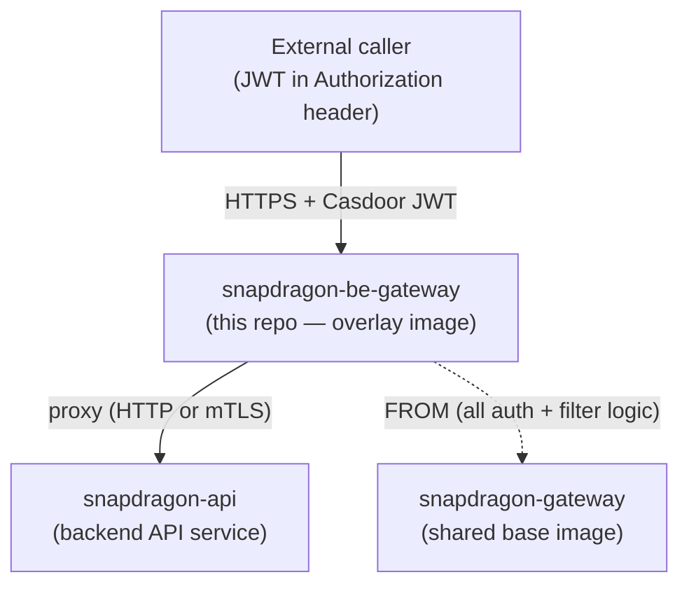
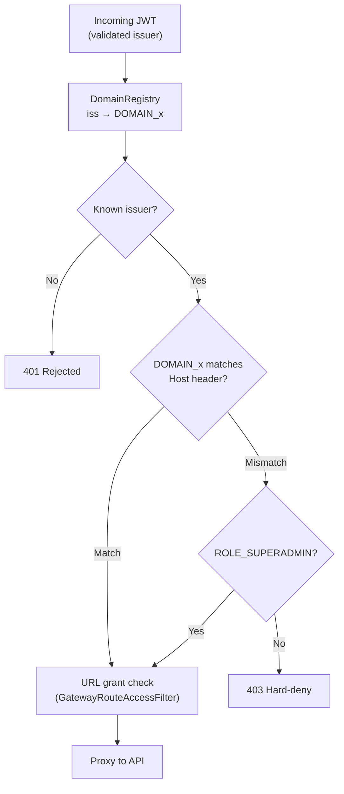

# snapdragon-be-gateway

The **backend front door** of a Snapdragon brand: a per-brand deployment of the
shared [snapdragon-gateway](https://github.com/Snapdragon-Systems/snapdragon-gateway)
Spring Cloud Gateway, placed in the **backend tier** to sit in front of the
backend API and the social homeservers (Matrix / Mastodon).

This repo is **not its own service codebase**. It is a thin **overlay** — a
minimal `Dockerfile` plus a config file and a Liquibase changelog — that re-uses
the audited `snapdragon-gateway` image and changes only three things:

1. its **identity** — `SPRING_APPLICATION_NAME=snapdragon-be-gateway`;
2. its **route set** — a single catch-all `Path=/**` route to the backend API;
3. its **downstream URI** — the in-cluster API service URL.

Everything else (the OAuth2 resource-server, the JWT-to-authority conversion, the
domain-scoping, the per-gateway route-access enforcement, revocation, downstream
mTLS) is **inherited unchanged** from the shared gateway image, so every device
runs identical, audited gateway code regardless of node type.



```bash
# GATEWAY_IMAGE must point at the sibling snapdragon-gateway image.
# CI resolves this automatically from the same namespace (see .gitlab-ci.yml);
# for local builds, supply whatever tag you have pulled locally.
docker build --build-arg GATEWAY_IMAGE=snapdragon-systems/snapdragon-gateway:dev \
  -t snapdragon-systems/be-gateway:dev .
```

---

## Current State

- **Last synced:** 2026-06-25
- **Baseline:** rides the **Spring Boot 4.0.7 / Spring Cloud 2025.1.2** ecosystem
  baseline (on Java 25) through the inherited `snapdragon-gateway` image (shared
  `snapdragon-parent` 2.7.0 metapom + `snapdragon-commons` 2.7.0 security/tenancy). This overlay
  carries no Java of its own, so it inherits the baseline transparently on the next
  build of the pinned `GATEWAY_IMAGE`.
- **SCG 5.0 route namespace — fixed & shipped on `main`.** Spring Cloud Gateway 5.0
  (Boot 4) moved route config from `spring.cloud.gateway.routes` to
  `spring.cloud.gateway.server.webflux.routes`; the legacy prefix silently binds
  **nothing**. `application-be.yml` now declares the `be-default` `Path=/**` route
  under `spring.cloud.gateway.server.webflux.routes`, so the catch-all to the backend
  API is honoured again. (Route-registry seeding via Liquibase into `gateway_routes`
  is unaffected — that path was never namespace-sensitive.)
- **Auth posture — pure Casdoor-JWT resource server.** The be-gateway validates the
  **internal Casdoor JWT** and runs the inherited authority/domain/route-access stack;
  it **exposes no login**. In the current SSO model, browsers hold only an opaque
  `bff_`-prefixed session and the per-session JWT custody/refresh + the `bff_`→custody-JWT
  swap live **upstream of this overlay** (login-ui + user-bff + the shared gateway
  pre-security filter), so nothing in this repo changes for that model.
- **Authorization data source.** Route-access rows remain admin-managed in Postgres
  (`gateway_route_access`, source of truth), CRUDed by `snapdragon-admin-bff-api`;
  this repo only seeds the `be-default` row into the `gateway_routes` **registry**.
- **Forgejo service-catalog deploy descriptor — shipped dark on `main`.** A
  `snapdragon-deploy.yaml` descriptor + a `deploy/` kustomize dir (the gateway Helm
  chart rendered byte-for-byte to static manifests) are on `main` for the Phase-6
  Forgejo catalog ApplicationSet. They **change nothing running**: the live ArgoCD
  source is still the `snapdragon-gateway` Helm chart in `snapdragon-generator`, and
  the GitHub-rooted control plane ignores these files until the Forgejo cutover.
- **CI:** GitLab (in-cluster). No GitHub Actions in this repo.

---

## Where it sits

| | |
|---|---|
| **Tier** | backend (data-plane front door) |
| **Namespace** | `snapdragon-backend` |
| **Identity** | `snapdragon-be-gateway` (the `gateway` column for its route-access rows) |
| **Downstream** | `snapdragon-api.snapdragon-backend.svc.cluster.local:8080` (override `DOWNSTREAM_URI`) |
| **Auth** | validates the **internal Casdoor JWT** as an OAuth2 resource server; **no external login is exposed** |
| **Base image** | `snapdragon-gateway` (one image, differentiated by `SPRING_APPLICATION_NAME`) |

A brand typically runs several gateway instances off this one shared image —
`snapdragon-be-gateway` (backend), `snapdragon-fe-gateway` (front door),
`snapdragon-pki-gateway` / `snapdragon-id-gateway` (identity), etc. — each
differentiated only by its `SPRING_APPLICATION_NAME`, route set, and
route-access rows. This repo is the backend instance.

### What's in this repo

| File | Purpose |
|------|---------|
| `Dockerfile` | `FROM ${GATEWAY_IMAGE}` then bakes the be identity + config + Liquibase changelog onto the shared image |
| `application-be.yml` | overlay config: `application.name`, the Casdoor `issuer-uri`, and the single `be-default` `Path=/**` route to the API, declared under `spring.cloud.gateway.server.webflux.routes` (SCG 5.0 / Boot 4 namespace; loaded via `SPRING_CONFIG_ADDITIONAL_LOCATION`) |
| `liquibase/changelog/db.changelog-master.xml` | Liquibase **master changelog** — the entry point the base gateway image runs; it `<include>`s `001-gateway-routes.xml` (`relativeToChangelogFile="true"`) |
| `liquibase/changelog/001-gateway-routes.xml` | seeds the `be-default` route (`Path=/**` → API) into the DB-backed route **registry** (`gateway_routes`) |
| `.gitlab-ci.yml` | builds + pushes this overlay image, basing the build off the sibling `snapdragon-gateway` image in the same in-cluster GitLab registry namespace |
| `snapdragon-deploy.yaml` | per-repo deploy descriptor for the Phase-6 Forgejo **service-catalog** ApplicationSet (name/namespace/image/port). **Ships dark:** the live ArgoCD source today is the `snapdragon-gateway` Helm chart in `snapdragon-generator`, so this descriptor + `deploy/` change nothing running until the Forgejo cutover |
| `deploy/` | the gateway Helm chart **rendered to static kustomize manifests** (`serviceaccount`/`configmap`/`service`/`deployment`/`ingress` + `kustomization.yaml`) — a verbatim, byte-identical dark copy of today's live render, kept for the Forgejo-source cutover; not consulted by the current GitHub-rooted ArgoCD |

CI is **GitLab** (in-cluster). There are no GitHub Actions workflows in this repo.

---

## Inherited capabilities (from `snapdragon-gateway`)

> **Reference summary only — not local behavior.** Everything in this section is
> owned by and **authoritative in**
> [`snapdragon-gateway`](https://github.com/Snapdragon-Systems/snapdragon-gateway),
> not in this repo. This overlay contributes only `application-be.yml` plus the
> `gateway_routes` seed (see [What's in this repo](#whats-in-this-repo)). Treat
> the descriptions below as a convenience digest; if they drift from the base
> gateway, the base repo wins.
>
> The base image is pinned by tag via the `GATEWAY_IMAGE` build-arg (CI passes
> `.../snapdragon-gateway:$CI_COMMIT_REF_SLUG`; see `.gitlab-ci.yml`), so the
> exact inherited code is traceable per build. To change base-gateway behavior,
> edit that repo — not this one.

Because this overlay uses the shared gateway image, the be-gateway inherits the
full authorization stack at no additional code cost. The pieces most relevant to
the backend front door are described below.

### Casdoor resource server + role authorities

Every request must carry a valid internal Casdoor JWT (issuer `CASDOOR_ISSUER_URI`,
default `https://id.snapdragon.systems`). The shared `CasdoorAuthorities` converter
maps the JWT claims to Spring Security authorities as follows:

- Every authenticated principal receives a `ROLE_USER` floor authority.
- The `roles` claim is mapped to `ROLE_<UPPER>` (handles Casdoor's string-or-object
  role representation).
- The `permissions` claim is mapped verbatim, **except** any entry starting with
  a reserved prefix (`ROLE_` or `DOMAIN_`) is dropped — this prevents
  authority-injection via a crafted token.
- The legacy `isAdmin: true` claim maps to `ROLE_ADMIN`.
- Exactly one `DOMAIN_<x>` authority is derived from the cryptographically-validated
  `iss` field (never from a user-settable claim), binding the principal to a brand.

The least-privilege cascade is `SUPERADMIN > ADMIN / MOD > USER` (where `MOD` and
`ADMIN` are siblings, neither subordinate to the other), plus the orthogonal
`ROLE_IMAGE_BUILDER` capability.

The browser-facing SSO model (login-ui Casdoor OIDC/PKCE redirect, user-bff
server-side code→token exchange + per-session JWT custody/refresh, and the opaque
`bff_`→internal-JWT swap performed by a shared pre-security gateway filter) is owned
upstream; from this overlay's perspective the request that reaches it already carries
a validated internal Casdoor JWT.

### Domain scoping (multi-tenancy)

`DomainRegistry` resolves the validated JWT issuer to a brand/domain name. The
feature is **opt-in and backward-compatible**:

- **Single-tenant (default):** with `APP_TENANCY_ISSUERS` unset, the single
  configured issuer maps to `DOMAIN_default` and the cluster behaves as before.
- **Multi-tenant:** when `APP_TENANCY_ISSUERS` is set, only the listed per-brand
  Casdoor issuers are trusted. A token from an unknown `iss` **fails closed (401)**
  rather than being silently accepted.

After JWT validation, `GatewayRouteAccessFilter` **hard-denies** any
non-`SUPERADMIN` principal whose `DOMAIN_<x>` authority does not match the target
domain derived from the `Host` header. This cross-tenant check fires before the
URL-grant layer is consulted, so a legitimately-authenticated user from brand A
can never reach brand B's resources. `ROLE_SUPERADMIN` is the **only** cross-domain
bypass — it exists solely for the infrastructure control plane.



### Authorization filter chain

After Spring Security validates the JWT, the shared `WebFilter` chain runs in
priority order. Filters are listed below as they apply to this gateway's
`Path=/**` backend route:

| Order | Filter | Role in front of the API |
|------:|--------|--------------------------|
| +100 | `RevocationGatewayFilter` | Rejects tokens that Casdoor has revoked (checked against a Cassandra-backed cache). |
| +200 | `ExternalAuthHeaderFilter` | Injects additive `External-Authorization` headers when an external OAuth token accompanies the request. This header is never required by the backend API. |
| +250 | `GatewayRouteAccessFilter` | Enforces per-gateway URL-access rules and the cross-domain hard-deny / `SUPERADMIN` bypass described above. |
| +300 | `ResourceAccessFilter` | Enforces per-resource grants. **This filter is inert for this gateway's catch-all route** — it gates specific path patterns on other sibling gateways, not the `Path=/**` API front door here. |

`ROLE_ADMIN` bypasses the access filters within its own domain, so the admin
who manages the route-access rules can never lock themselves out.

Requests that carry an opaque homeserver bearer token instead of a Casdoor JWT
(Matrix / Mastodon passthrough traffic) are handled separately by the
`HomeserverTokenRevocationFilter`.

### Per-gateway route access

`GatewayRouteAccessService` enforces the admin-managed rules that decide which
roles or users may reach which URLs through **this** gateway. **Postgres is the
source of truth** (`ROUTE_ACCESS_R2DBC_URL`): on startup the pod loads the
`gateway_route_access` rows scoped to its own `spring.application.name` (=
`snapdragon-be-gateway`), write-through-mirrors them into Cassandra as a
read-cache, and refreshes on each tick. The fallback chain is:

1. Postgres (authoritative) — used when reachable.
2. Cassandra cache — used when Postgres is briefly unavailable.
3. Baked-in canonical seed — last resort; **never silently fail-open**.

The admin-bff service (`snapdragon-admin-bff-api`) creates and manages the
canonical `gateway_route_access` rows. Match semantics: longest `url_pattern`
wins; an explicit `allow=false` row denies; the `PUBLIC` sentinel permits
anonymous traffic.

> **Which table this repo touches.** There are two distinct route tables — do
> not confuse them. This repo's Liquibase changelog seeds only the
> `gateway_routes` **route registry** (one row: `be-default`, `Path=/**` → API).
> The `gateway_route_access` **authorization** rows scoped to
> `spring.application.name=snapdragon-be-gateway` are seeded and managed
> exclusively by `snapdragon-admin-bff-api`, not here.

### Downstream mTLS (gateway → API)

When the backend API enforces mTLS (`server.ssl.client-auth=need`), set
`SNAPDRAGON_GATEWAY_MTLS_ENABLED=true`. The gateway will then present a client
certificate chaining to the cluster CA on the outbound proxy leg; the key material
is assembled in-pod from `snapdragon.tls.*` properties (passwords are never stored
in git). The default is `false`, which keeps local, dev, and CI environments
proxying over plain `http://`. **Inbound (public) callers are unaffected** — this
flag controls only the gateway's outbound TLS client identity.

---

## Configuration

The table below covers the env vars relevant to this overlay. The full set of
base-gateway variables is documented in `snapdragon-gateway`.

| Env var | Default | Purpose |
|---------|---------|---------|
| `SPRING_APPLICATION_NAME` | `snapdragon-be-gateway` | gateway identity + route-access `gateway` key (baked into the image) |
| `CASDOOR_ISSUER_URI` | `https://id.snapdragon.systems` | trusted Casdoor issuer for JWT validation |
| `DOWNSTREAM_URI` | `http://snapdragon-api.snapdragon-backend.svc.cluster.local:8080` | the API this gateway fronts |
| `APP_TENANCY_ISSUERS` | _(empty)_ | CSV `issuerUri=domain,…` — enables multi-brand mode (empty ⇒ single-tenant `default`) |
| `APP_TENANCY_HOSTS` | _(empty)_ | CSV `hostSuffix=domain,…` — defense-in-depth Host→domain map |
| `ROUTE_ACCESS_R2DBC_URL` | _(empty)_ | Postgres source-of-truth for route-access rows (empty ⇒ Cassandra-cache/seed only) |
| `SNAPDRAGON_GATEWAY_MTLS_ENABLED` | `false` | Present a client certificate to the mTLS-enforcing backend API. |

**Multi-tenant example** — to trust two brands with separate Casdoor instances:

```bash
APP_TENANCY_ISSUERS="https://id.alpha.example.com=alpha,https://id.beta.example.com=beta"
APP_TENANCY_HOSTS=".alpha.example.com=alpha,.beta.example.com=beta"
```

With these values set, a JWT with `iss=https://id.alpha.example.com` yields
`DOMAIN_alpha`, and a request to a `Host: api.beta.example.com` endpoint with
a `DOMAIN_alpha` principal is hard-denied before URL grants are checked.

---

## Relationship to the platform

- **Gateways** — one shared `snapdragon-gateway` image powers every gateway in the
  platform. This overlay is the backend instance. The `fe-gateway` and identity
  gateways (`pki-gateway`, `id-gateway`) are siblings built the same way. An
  optional games gateway is a further sibling, created when the opt-in games
  service is enabled.
- **Casdoor** — this gateway is a resource server only. It validates JWTs minted
  by the brand's Casdoor instance and never exposes a login endpoint itself.
  Browser-facing SSO (OIDC/PKCE) is handled by login-ui + user-bff, which hand
  this gateway a validated internal JWT.
- **Federation** — the same domain-scoping and route-access rules that gate
  ordinary traffic also gate federated and remote surfaces. `SUPERADMIN` is the
  only role with cross-domain reach.
- **Multi-tenancy** — each per-brand gateway instance carries its own issuer,
  `SPRING_APPLICATION_NAME`, and route-access rows. The `DOMAIN_<x>` authority
  and the cross-domain hard-deny together enforce brand isolation at the network
  edge.

---

## Roadmap

> **State convention:** 🚧 **in-flight** = code on an open branch or PR, not yet
> merged · 🔭 **planned** = design-complete, no code yet. Nothing below is shipped
> on `main`. All items below are **upstream / inherited** changes — none are
> expected to require edits to the files in this overlay repo, but each will affect
> how this be-gateway behaves once the base `snapdragon-gateway` image (pinned by
> `GATEWAY_IMAGE`) picks them up.

- 🚧 **SSO end-to-end + e2e.** The Casdoor OIDC/PKCE login model (login-ui → user-bff
  custody JWT → opaque `bff_` browser session, swapped to the internal JWT by the
  shared pre-security gateway filter) is being driven to a live, e2e-tested state
  upstream. This be-gateway inherits the `bff_`→JWT swap from the base image; no local
  change here.
- 🚧 **MFA-gated routes (Casdoor MFA).** A base-gateway capability: a new
  `gateway_route_access.mfa_required` column, plus `amr`/`acr` → `MFA_SATISFIED`
  authority mapping with **fail-closed** enforcement. Once shipped upstream, the
  be-gateway will inherit `mfa_required` checks on its backend routes automatically.
  No change to this repo is required — the effect is entirely in the
  `gateway_route_access` rows managed by admin-bff for `snapdragon-be-gateway`.
- 🚧 **New backend API surfaces behind `Path=/**`.** Notifications external channels
  (Matrix DM / Akkoma feed / phpBB / email adapters) and the Workload Console
  (admin-bff changelog 110-band) add new API endpoints that the catch-all route
  will front. No change to this repo; if a future README enumerates the backend API
  surface, those endpoints must be marked roadmap rather than shipped.
- 🔭 **Auth-core relocation (upstream).** Login/session/account logic is being
  relocated from admin-bff to user-bff, with shared account/session/MFA/Casdoor-admin
  infra extracted to `snapdragon-auth-core` (consumed by user-bff + admin-bff only).
  This is invisible to the be-gateway — it still validates the internal Casdoor JWT —
  but it is why admin-bff remains the CRUD owner of `gateway_route_access` while
  account/session **data** stays in admin-bff-db.
- 🚧 **Upstream supply-chain hardening.** Base-image and binary checksum/GPG
  verification is being added in the generator and base build pipeline, not here.
  This overlay will receive the hardened base image transparently on the next build,
  because `GATEWAY_IMAGE` is pinned by tag.
